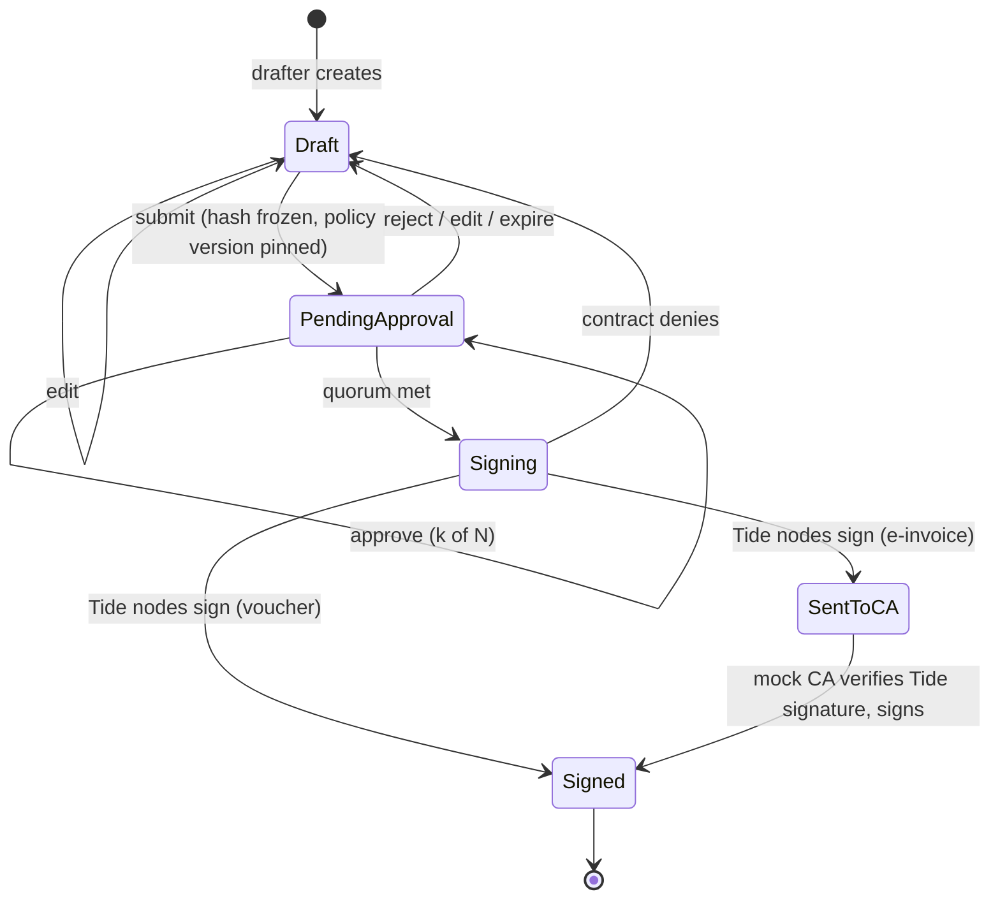

# SignGuard — Build Plan

SignGuard makes sure **no single person can get a high-value company document signed alone**. The record of who approved it is cryptographic, not a database row anyone with server access could edit.

This plan builds on the two Word documents in this folder: the pitch and the MVP App Plan. It updates the App Plan with what Tide's own tooling (the `tide-pack` MCP server, "Raziel") confirmed about how TideCloak works.

---

## 1. What's decided

| Area | Decision |
|---|---|
| Identity and keys | TideCloak, running in local Docker on the live Tide network, free tier |
| Frontend | Vue 3 + Vite + Pinia, using `@tidecloak/js` |
| Backend | Node + TypeScript (Express), using `@tidecloak/verify` for token checks |
| Database | SQLite (zero setup for teammates), behind repository interfaces |
| Signing rules | Tide's **built-in** `GenericRealmAccessThresholdRole:1` contract: no deployment needed. A custom contract (C#) is compiled as an optional upgrade for Tide's team |
| Encrypted fields | Tide's built-in `RelationshipAttestation:1` contract (nothing to deploy) |
| New-user form | First name and last name only |
| Login screen | Generated SignGuard branding instead of Tide's logo |
| CA | Mock adapter standing in for VNPT SmartCA / Viettel MySign |

**Rule:** we never implement key splitting, threshold signing or encryption ourselves. All of it goes through TideCloak and its SDKs.

---

## 2. How TideCloak fits

```
 Our machine (Docker)                       Internet
┌───────────────────────────┐        ┌──────────────────────────────┐
│ TideCloak  :8081          │◄──────►│ Tide network: 20 ORK nodes   │
│ realm "signguard"         │        │ each holds one key fragment  │
│ users, sg_* roles, login  │        │ 14 of 20 must agree to sign, │
└─────────────▲─────────────┘        │ decrypt or issue a token     │
              │ login, tokens        └──────────────────────────────┘
┌─────────────┴─────────────┐
│ Vue app :5173             │──── API calls (token + DPoP) ────┐
└───────────────────────────┘                                  ▼
                                               ┌───────────────────────────┐
                                               │ Node API :3000            │
                                               │ routes → use cases → domain│
                                               │ SQLite, mock CA           │
                                               └───────────────────────────┘
```

| Need | Tide feature | How SignGuard uses it |
|---|---|---|
| Sign-in | Threshold password login: no server ever sees or stores the password | Vue redirects to TideCloak; the API checks the token against the public key in `tidecloak.json` |
| Tiers | Realm roles carried in the token | `sg_viewer`, `sg_drafter`, `sg_approver`, `sg_director`, `sg_owner` (already created) |
| Changing who holds a tier | IGA: role grants become change requests that admins must sign | "Change approvers or policy" needs no custom code |
| Quorum-gated signing | Forseti contract run by the Tide nodes | The nodes refuse to sign unless enough distinct, eligible people approved |
| Sealed fields | `RelationshipAttestation:1` policy encryption | Counterparty and bank details are readable only by the roles the policy names |

### Corrections to the original App Plan

1. **Plain `doEncrypt` is the wrong tool for shared fields.** It is self-encryption: only the person who encrypted can decrypt, even if others get a decrypt role. Use policy-governed encryption (`IAMService.doEncrypt(data, signedPolicy)` with `RelationshipAttestation:1`). The realm already has its `_tide_encryptor` / `_tide_decryptor` roles.
2. **The amount stays in plaintext.** The API needs it to pick the approval rule, and the contract needs it to check the tier. Seal the counterparty, bank account and description instead.
3. **IGA quorum is `max(1, floor(admins × 0.7))`.** With 1 or 2 realm admins, one approval is enough. For "owner + one other" on governance changes, give **3 people** `tide-realm-admin`.
4. **Found during the build: no custom contract is needed to ship.** Every ORK has `GenericRealmAccessThresholdRole:1` built in ("at least N approvers holding realm role X"). SignGuard signs each document's approval statement through it, using the network's policy-signing model (the pattern in Tide's attestation template). The server enforces the rest (distinct people, initiator excluded, the director + owner mix). The custom contract in `app/contracts/` moves those checks onto the network too, as an upgrade.
5. **Found during the build: TideCloak allows one pending change request per person.** Granting several roles at once files only the first. Tier changes are therefore filed one role at a time (`npm run grant -w backend`, or Members → Request change, repeated after each approval).

### Answers to the App Plan's open questions

| Question | Answer |
|---|---|
| Can a contract count distinct approvers? | **Yes.** In explicit-approval mode, `ValidateApprovers` receives every approver's Tide token (`ctx.Dokens`) and can require "at least N with role X" (`RequireMinWithRole`). |
| Where does an approver's proof come from? | Each approver signs in Tide's approval window in their own browser. That signed token travels with the signing request. |
| Does IGA cover role grants to regular users? | **Yes.** `GRANT_ROLES` and `CREATE_USER` are governed actions. |
| Backend language? | Node + TypeScript: Tide ships `@tidecloak/verify` for token and DPoP checks. There is no Python equivalent. |
| Network and licence? | Settled: the live Tide network on the free tier. |
| CA sandbox? | Still open. We build on the mock. |

---

## 3. The core flow

### Signing-request lifecycle



### Step by step

1. **Draft.** A drafter (e.g. the accountant) creates a payment voucher or e-invoice. The editor shows which approval rule will apply before they submit.
2. **Submit.** The API computes the document's content hash and freezes it. It opens a `SigningRequest` that keeps a snapshot of the policy version in force. Any later edit cancels the request and returns the document to Draft.
3. **Approve.** Each eligible approver opens the request on their phone and checks the amount, counterparty and hash summary. They approve in **Tide's approval window**. The API rejects the initiator, duplicates and anyone in an ineligible tier. Tide's nodes check these rules again in step 4.
4. **Sign.** When quorum is met, the request goes to the Tide nodes with all approvers' tokens. The contract runs on each node:
   - `ValidateData`: the hash format, the document type, and the amount (parsed from a **string**, since amounts over 2.1B VND overflow `int`).
   - `ValidateApprovers`: distinct people, the required tiers for that amount band, and **the initiator never counted**.
   - `ValidateExecutor`: the caller holds the signing role and their token hasn't expired.
5. **Result.** The nodes produce an Ed25519 signature over the approval payload, which the API stores as a `SignatureReceipt`. A voucher is finished at this point. An e-invoice goes on to the mock CA, which **verifies Tide's signature first** and only then "signs". This is how a real SmartCA gateway would gate its key.
6. **Audit.** Every step appends a hash-chained `AuditEntry`, so changing any past entry breaks the chain.

### Approval policy (from the pitch)

| Amount (VND) | Required approvals |
|---|---|
| < 20,000,000 | Drafter alone, logged |
| 20,000,000 – 500,000,000 | Drafter + director |
| > 500,000,000 | Drafter + director + owner |
| Change approvers or policy | Owner + one other, through TideCloak IGA |

The drafter's part is **submitting**. Every approval counted toward the quorum must come from someone else. So "2 of 3" on screen means the submission plus one approval, and the initiator can never approve their own request.

### What is signed

The Tide nodes sign a canonical **approval payload**, not the PDF:

```
{ docId, docType, contentHash (SHA-256), amountVnd (string), policyVersion, requestId }
```

The contract reads these fields, which keeps the payload small and deterministic across all 20 nodes.

---

## 4. Screens

Nine screens. **The Inbox and the Approve sheet are designed for a phone first.** Everything else is desktop-first and responsive.

| # | Screen | Shows / does | Main user |
|---|---|---|---|
| 1 | Sign in | Redirects to TideCloak's branded login; we store no password | Everyone |
| 1b | Welcome form | First and last name on first login (Tide accounts start with neither) | New users |
| 2 | Inbox | Requests waiting for me, my drafts, recently signed | Everyone |
| 3 | Documents | List filtered by type, status, group and amount; sealed fields hidden without the decrypt role | Viewer+ |
| 4 | Document editor | Create or edit a draft voucher or e-invoice; previews which rule applies | Drafter |
| 5 | Document detail | Fields, approval progress ("2 of 3"), timeline, signature receipt | Everyone |
| 6 | Approve sheet | Amount, counterparty, hash summary, approve / reject through Tide | Approver, director, owner |
| 7 | Policy | Current rules; propose a change, shown as pending until the IGA quorum clears it | Owner (others read-only) |
| 8 | Members | Invite, change tier; changes show as pending IGA requests | Owner |
| 9 | Audit log | Event list, chain-verification badge, export | Director, owner |

### Wireframes

**Inbox (phone)**

```
┌──────────────────────────────┐
│ SignGuard          Nguyễn A ◐│
├──────────────────────────────┤
│ Waiting for you (2)          │
│ ┌──────────────────────────┐ │
│ │ Phiếu chi #0142          │ │
│ │ 640.000.000 ₫  ●● ○  2/3 │ │
│ │ Công ty TNHH Minh Phát   │ │
│ │ from Trần B · 12 min ago │ │
│ └──────────────────────────┘ │
│ ┌──────────────────────────┐ │
│ │ Hóa đơn #E-0031          │ │
│ │ 85.000.000 ₫   ● ○   1/2 │ │
│ └──────────────────────────┘ │
│ My drafts (1)              › │
│ Recently signed (5)        › │
├──────────────────────────────┤
│  Inbox   Docs   Audit   Me   │
└──────────────────────────────┘
```

**Approve sheet (phone)**

```
┌──────────────────────────────┐
│ ← Phiếu chi #0142            │
├──────────────────────────────┤
│        640.000.000 ₫         │
│ Rule: >500M → director+owner │
│                              │
│ To      Công ty TNHH Minh Phát│
│ Bank    VCB ••••4821         │
│ By      Trần B (drafter)     │
│ Hash    3f9a…c21e  ⧉         │
│                              │
│ Approvals  ●● ○   2 of 3     │
│  ✓ Trần B   submitted        │
│  ✓ Lê C     director         │
│  ○ You      owner            │
├──────────────────────────────┤
│ [  Reject  ] [ Approve ✓  ]  │
│  Approving opens Tide to     │
│  confirm it's really you.    │
└──────────────────────────────┘
```

**Document detail (desktop)**

```
┌────────────────────────────────────────────────────────────────┐
│ SignGuard   Inbox  Documents  Policy  Members  Audit   Nguyễn A│
├────────────────────────────────────────────────────────────────┤
│ Phiếu chi #0142                         ● Pending approval 2/3 │
│ ┌──────────────────────────────┐ ┌───────────────────────────┐ │
│ │ Amount     640.000.000 ₫     │ │ Timeline                  │ │
│ │ Type       Payment voucher   │ │ 09:12 Trần B created      │ │
│ │ Group      Operations        │ │ 09:30 Trần B submitted    │ │
│ │ Payee      🔒 Minh Phát      │ │ 09:41 Lê C approved ✓     │ │
│ │ Bank       🔒 VCB ••••4821   │ │ —     Nguyễn A (owner)    │ │
│ │ Hash       3f9a…c21e         │ │                           │ │
│ │ Policy     v3 · over 500M    │ │ Signature receipt         │ │
│ └──────────────────────────────┘ │ not yet signed            │ │
│                                  └───────────────────────────┘ │
└────────────────────────────────────────────────────────────────┘
```

### Every screen needs these states

| State | What the user sees |
|---|---|
| Loading | Skeleton rows, never a blank page |
| Empty | "Nothing waiting for you" + what to do next |
| Sealed, no access | 🔒 "Hidden: you don't have access to this field" (never a decryption error) |
| Pending IGA | Amber "Waiting for owner approval" badge on tier and policy changes |
| Tide pop-up blocked | Inline banner: "Allow pop-ups for SignGuard to approve" |
| Contract denied | The node's reason in plain words, e.g. "Initiator can't approve their own request" |
| Offline / TideCloak down | Banner: "Sign-in service unreachable"; read-only views still work from cache |

---

## 5. Visual design

**Tone:** a calm, serious finance tool. It should feel closer to a banking app than a startup dashboard.

### Colour tokens

| Token | Light | Dark | Use |
|---|---|---|---|
| `--bg` | `#F7F8FA` | `#0E1116` | Page background |
| `--surface` | `#FFFFFF` | `#171B22` | Cards, sheets |
| `--text` | `#14171F` | `#E8EAF0` | Body text |
| `--muted` | `#5B6372` | `#9AA3B2` | Secondary text |
| `--brand` | `#1E3A8A` | `#7C9BFF` | Primary buttons, links (deep navy) |
| `--approved` | `#15803D` | `#4ADE80` | Approved, signed, chain OK |
| `--pending` | `#B45309` | `#FBBF24` | Waiting, pending IGA |
| `--rejected` | `#B91C1C` | `#F87171` | Rejected, denied, chain broken |
| `--sealed` | `#6D28D9` | `#A78BFA` | 🔒 sealed-field markers |

Status is **never shown by colour alone**: every badge has a word and an icon (✓ ● ✕ 🔒).

### Type and formatting

- **Font:** *Be Vietnam Pro* (Google Fonts). It renders Vietnamese diacritics cleanly. Use tabular numerals for amounts.
- **Money:** always VND with Vietnamese grouping (`640.000.000 ₫`), stored as an integer of đồng and never a float. Show the amount larger than anything else on the Approve sheet.
- **Hashes:** the first 4 + last 4 characters with a copy button (`3f9a…c21e ⧉`); the full value on tap.
- **Language:** Vietnamese labels for document types and statuses (Phiếu chi, Hóa đơn), English for the rest in the MVP. Everything goes through one i18n file so a full Vietnamese UI is a translation job, not a code change.

### Layout

- **Phone:** bottom tab bar (Inbox, Docs, Audit, Me). The Approve sheet has thumb-reach buttons and **Reject on the left, Approve on the right**.
- **Desktop:** top navigation, a two-column document detail (fields | timeline).
- Minimum 44 px touch targets, WCAG AA contrast in both themes.

### Login branding

Generated with Tide's branding tool, using its finance preset and SignGuard's name, before we demo. It replaces Tide's logo on the sign-in screen.

---

## 6. Architecture

### Repository layout

```
/
├── tidecloak/            local TideCloak: bootstrap.py, realm template, .env (gitignored)
│   └── docs/             this plan + the pitch and MVP plan (.docx, gitignored)
├── contracts/            SignGuardPolicy.cs + compile harness
├── backend/              Node + TypeScript API
│   └── src/
│       ├── domain/       pure classes, no imports from outside
│       ├── usecases/     one class per user intention
│       ├── gateways/     TideGateway, CaSigningGateway, repositories (interfaces + adapters)
│       └── routes/       HTTP only: verify token, call use case, map result
└── frontend/             Vue 3 + Vite
    ├── public/tide_dpop_auth.html   copied from Tide's pack, never hand-written
    └── src/
        ├── composables/useTide.ts   the ONLY place that calls @tidecloak/js
        ├── stores/       auth, documents, signingRequests, policy (Pinia)
        └── views/        the nine screens
```

### Domain model (unchanged from the App Plan)

| Class | Kind | Owns |
|---|---|---|
| Organization | Aggregate root | members, resource groups |
| Member | Entity | tier (read from Tide roles, never set locally), `canApprove(doc)` |
| ResourceGroup | Entity | who may draft or edit which documents |
| ApprovalPolicy | Aggregate root | versioned rules; `requirementFor(doc)` |
| ApprovalRule | Value object | doc type, amount range, required tiers, quorum |
| Document | Aggregate root | type, Money, sealed fields, status, ContentHash; `submit()` freezes the hash |
| SigningRequest | Aggregate root | requirement snapshot, initiator, approvals; `approve()` rejects initiator, duplicates, wrong tier |
| Approval | Value object | member, decision, time, Tide proof |
| SignatureReceipt | Value object | provider (Tide / CA), signature, time |
| AuditEntry | Entity, append-only | event, actor, doc hash, `prevHash` |

**Invariants:**
- A submitted hash never changes.
- The initiator never counts toward their own quorum.
- A request keeps the policy version it started with.

### API routes

| Route | Use case | Who |
|---|---|---|
| `GET /me` | Current member and tier | Signed in |
| `POST /documents` | CreateDraft | Drafter |
| `PATCH /documents/:id` | EditDraft (Draft only) | Drafter |
| `GET /documents/:id` | ViewDocument (sealed fields decrypted in the browser) | Viewer+ |
| `POST /documents/:id/submit` | SubmitForSigning | Drafter |
| `GET /signing-requests?mine=pending` | ListPendingApprovals | Approver+ |
| `POST /signing-requests/:id/approve` | ApproveRequest; triggers ExecuteSigning on quorum | Eligible tier, not initiator |
| `POST /signing-requests/:id/reject` | RejectRequest | Eligible tier |
| `GET /policy` · `POST /policy/drafts` | ViewPolicy · ProposePolicyChange (through IGA) | Viewer · Owner |
| `POST /members/invite` · `POST /members/:id/tier` | InviteMember · ChangeTier (through IGA) | Owner |
| `GET /audit` · `GET /audit/verify` | ListAudit · VerifyAuditChain | Director+ |

**Every route verifies the Tide token, the DPoP proof and the role on the server.** Hiding a button in Vue is never the security check.

---

## 7. Build order

| Step | Deliverable | Done when |
|---|---|---|
| 0 ✅ | TideCloak realm, client, tier roles, admin linked | `tidecloak.json` exported. **Done 2026-10-22.** |
| 1–6 🟡 | **Built 2026-10-22** in `tidecloak/app` (see its README): every screen, the full flow, sealed fields, IGA tier changes, mock CA, Tide-signed audit anchors. 109 automated tests pass with real cryptography and a simulated Tide network. | Still to confirm against the live network: rule signing, field encryption, the enclave approval card, signature verification over the statement (README → "What has NOT been verified") |
| 1 | Vue sign-in + DPoP page + `GET /me` on the API | Logging in shows your name and tier, and the API rejects a token from another device |
| 2 | Domain core with unit tests, no database | Money, Document, ApprovalPolicy, SigningRequest and AuditEntry pass their invariant tests |
| 3 | Approval flow with signing stubbed | Inbox → Approve sheet → "2 of 3" works across two browsers |
| 4 | Forseti contract + ExecuteSigning | Compiles locally; **sent to Tide's team on day one of this step** |
| 4b | Fallback signing | If the contract isn't deployed in time, the API proves quorum itself and Tide signs a payload that includes every approval proof |
| 5 | Sealed fields + IGA tier changes | A viewer without the role sees 🔒; a tier change waits for approval |
| 6 | Mock CA, Đồng Tháp replay, audit export, Tide-signed audit anchors | The demo script runs end to end, and editing a past audit row in SQLite fails verification even if the chain is recomputed |

### Demo script: the Đồng Tháp replay

1. The seeded company has the same setup as the real case: one accountant who used to hold the signing token alone.
2. The accountant submits a fake 450M VND voucher. It **stops at "1 of 2"**.
3. They try to approve it themselves. The API refuses, and so does the contract on Tide's nodes.
4. The director sees it on their phone, notices the unknown payee and rejects it. The audit log shows every step, and the chain verifies.
5. Closing line: *"173 vouchers went through because one person held the key. With SignGuard, none would have."*

---

## 8. Risks and how we handle them

| Risk | Plan |
|---|---|
| ~~Tide's team doesn't deploy our contract in time~~ | **Resolved:** the built-in threshold contract needs no deployment. The custom contract is an optional upgrade |
| The live enclave renders or counts a `Policy:1` approval differently than the docs suggest | Test the first real approval early. Errors show the network's own message, and the codec is byte-checked against the SDK |
| Contract checks client roles, our tiers are realm roles | Verify before writing the contract. If needed, add client roles (one IGA approval) |
| Multi-approver request mechanics in the SDK differ from the docs | Spike it in step 3 with two browsers before building the screens around it |
| Phones can't reach `localhost` | Use an HTTPS tunnel (e.g. Cloudflare) and register its URL early. Each new URL is one IGA approval |
| Only one person's PC hosts TideCloak | Pick the demo machine now. Teammates point their apps at it or run their own realm with `python tidecloak/bootstrap.py` |
| One realm admin = single point of failure | Add 2 more `tide-realm-admin` holders before the demo (quorum becomes 2) |

### Where the platform still holds power

The claim we want to make is: *"No one at SignGuard, including us, can log in as a user, approve on their behalf, or produce a signature without the required approvals."* That holds for passwords, login tokens, approval proofs, signatures, sealed fields and role changes, whose keys exist only as pieces across Tide's nodes. Five things weaken it, and each needs handling:

| # | Where | Why it matters | Plan |
|---|---|---|---|
| 1 | **Local TideCloak admin password** (`KC_BOOTSTRAP_ADMIN_PASSWORD`) | Can't forge logins or approve role changes after the multiAdmin flip. It can still change settings that IGA doesn't govern (user details, identity-provider settings) and can stop the service. | Treat it as an operations key: keep it in `.env` only, never in code. Beyond local Docker, keep it in a secret manager. |
| 2 | **Our database** | Nobody can fake an approval or a signature. But whoever controls the server could rewrite the *entire* audit chain so it still verifies. | **Anchor the chain:** have Tide sign the latest audit-chain hash at intervals (e.g. on every signed document). Rewriting history then breaks a signature the server can't redo. Added to step 6. |
| 3 | **Rules only the server enforces** | The built-in contract makes the network count approvers holding the band's role. The server alone enforces distinct people, the initiator exclusion and the director + owner mix. A compromised server still cannot create an approval, but it could copy one person's genuine approval twice into the request, and the built-in contract may count it twice. It could also accept the initiator's own approval. | Ship on the built-in contract. Send `app/contracts/SignGuardApprovalContract.cs` to Tide's team to move these checks onto the network. Unsigned dev mode exists only behind `SIGNGUARD_ALLOW_UNSIGNED_DEV` and is labelled everywhere. |
| 4 | **Real CA credential (post-hackathon)** | VNPT / Viettel hold the legal signing key, and calling their API needs an API credential. Tide can't split an arbitrary API password. Kept on our server, it would be a master key. | The clean design needs the CA to **verify Tide's signature before it signs**, as our mock CA does. That's a partnership conversation, and the pitch should present it as such. |
| 5 | **Realm offboarding (Ragnarok)** | Setup enabled Tide's offboarding option (`isRagnarokEnabled=true`), the one path that deliberately rebuilds keys in one place so a customer can leave the network. | **Unconfirmed:** who can trigger it and what approvals it needs. Check with Tide before the demo, and disable it if we don't need it. |

---

## 9. Running TideCloak locally

1. Start Docker Desktop. The container `tidecloak` serves `http://localhost:8081`. Port 8080 is taken by another service on the host machine.
2. The local admin console is `http://localhost:8081/admin/`, signed in as `admin` with the password in `tidecloak/.env`. That account can no longer approve changes.
3. **Approving changes:** go to `http://localhost:8081/realms/signguard/tide-console/` → Change Requests and sign in with your **Tide account**. Approve, then sign in Tide's pop-up window.
4. **Rebuilding from scratch** (wipes the realm): `FORCE_WIPE=1 python tidecloak/bootstrap.py`. You'll get a new invite link and need a new Tide account.

---

## 10. Still open

- [ ] VNPT SmartCA / Viettel MySign sandbox credentials, or stay on the mock for the hackathon?
- [ ] Which machine hosts the demo TideCloak, and who are the 3 realm admins?
- [ ] UI language: Vietnamese-first or English-first for the judges?
- [ ] Confirm with Tide's team: realm roles vs client roles in `ValidateApprovers`, and the deployment timeline for our contract.
- [ ] Confirm with Tide's team: who can trigger Ragnarok offboarding on our realm, and whether to turn it off.
